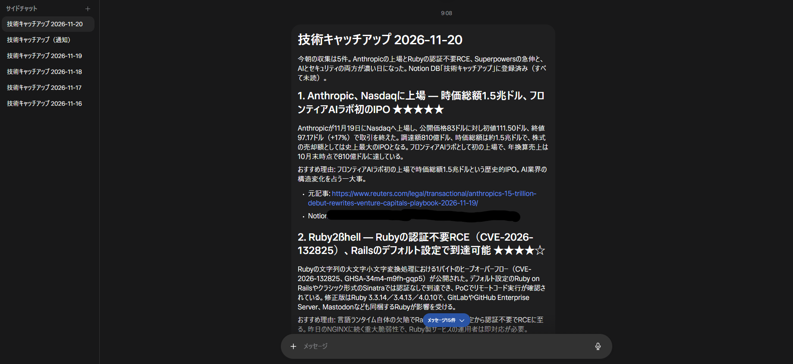
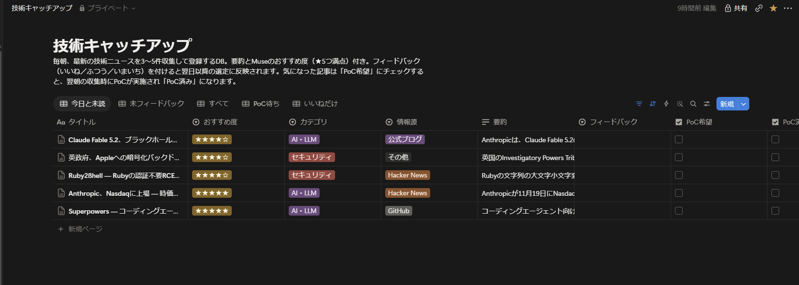
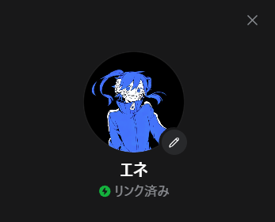

## はじめに

タイトルにもある通り、MetaのMuseを使ってみました。
(初めて聞いたとき、薬用石鹸のほうかと思いました)

私の使い方だったり、使ってみた感想を共有します。

## Museとは？

Museを知らない方もいると思うので軽くMuseの説明をします。
MuseはMeta産のAIエージェントです。
特徴としては、以下が挙げられます。

- Instagramやチケットぴあなど、日常で良く使うアプリケーションの連携ができる
- Meta側のVMで動作するため、物理デバイスの電源がオフでも動作する
- セキュリティに強い(らしい)
- アイコンが可愛い(変更可能)

https://about.fb.com/ja/news/2026/10/muse-personal-ai-agent-launches-in-japan/

類似サービスとしては以下があります。

- Dots(OpenAI)
- Grok Bot(SpaceXAI)
- Cloud Duet(Anthoropic)

チケットぴあや、Instagramなどの連携を推していることから、一般の消費者向けのパーソナルAIという位置づけを目指しているのかなぁと思いました。
(売り方がうまいなぁと思いました。)

## で、どんな使い方してるの？

私の使い方としては、技術関連のキャッチアップ用途として使っています。
具体的には以下のような運用フローを想定してタスクを作成しました。

1. 朝9時に技術ニュース5つをMuseから通知
2. 人間がコーヒーを飲みながらスマホで読んでフィードバック
3. フィードバック結果は次の日に取ってくる技術ニュースを選ぶ際の参考にする
4. PoCマークを付けることで次の日の技術ネタ探索の際にPoCをClaudeCodeで作成する

そのため、現時点では以下のサービスと連携しています。

- Notion
- GitHub
- Claude

毎日、以下のような通知がMuseから送られてきます。



NotionにはDBを作成しており、Museが集めてくれたものがどんどん溜まっていきます。

私(人間)がフィードバックして、Museが次の日にそのフィードバックを参考にするというループを回す構成にしています。



NotionからPoCチェックボックスにチェックをつけることで、次の日の記事集めの日にClaude Codeを利用してPoCを作ってGithubにPushしてくれるようにしています。(今のところ利用実績なし)

最近はSkill関連とセキュリティ関連に関心があり、かなり偏ったものをお勧めされてます笑

## 使ってみてどうよ？

### 良い点

以下です。

- クラウド上のVMで実行されるためPCの電源オフでも動いてくれる(帰省とか旅行の時にPCをオンにしておく必要がないので電気代がかからない)
- アバターやMuse自身の名前の変更が可能(かなり良い。。)
- 連携用のAPIキー等の秘匿情報をセキュアなフォームからMuseに連携できる
- ユーザを集めている段階なのかトークンがとんでもなく多い

1点目、3点目、4点目は書いてある通りです。
2点目に関してちょっと捕捉します。

利用者は初回のチャット時にMuseに命名します(ポチなど・Muse君など)。

またアバターについても変更可能で愛着がわきます。
ちなみに私のMuseの名前はエネにしています。



(世代がばれるかもなので、ちょっと恥ずかしい。。)

アバターの変更はサムネイルだけの変更でなく、なんと**動きます**。
興味が湧いてきた方は自分の好きなキャラをアバターにして、使ってみてください！！

### 悪い点

以下です。

- MuseのメインチャットはClaudeの`/clear`のようなことができない(設計みたいなことをメインチャットでやってしまうとコンテキストを消せない)
- 自律的に動きすぎる(勝手に動くから心配になる)
- 体感、思考時間が長いように感じる
  
特に1点目はこれから使う方か注意したほうが良いかもしれないです。

私は説明書とか事前の下調べとかせずに使うタイプなのでメインチャットが汚れてしまいました。。。。

Muse自身に聞いてみたところ以下のような使い分けがおすすめみたいです。

```text:Muse回答
メイン = 司令塔
- 1〜2往復で終わる短い相談、質問
- 方針・設計みたいな大事な意思決定
- 複数テーマにまたがる話、「今日どれからやる？」みたいな全体の整理
- メインはアーカイブもクリアもできないから、ここを軽く保つのが一番大事

サブ（サイドチャット） = 作業部屋
- 1テーマにつき1スレッド
- 長くなりそうなプロジェクト、調査、深掘り
- 実行ログや定期報告が溜まるもの
- 終わったらアーカイブして片付けられる
```

個人的には設計とかもサブのほうが他のコンテキストと混在しないので、良いと思ってます。

## 最後に

ここまで読んでいただきありがとうございました。
この記事を読んで、タメになった、読んでよかったと思ってもらえたら嬉しいです。
ありがとうございました！！

## 記事を書いて思ったこと

(こういう記事は、techにするのかideaにしようか迷う。。。。。。)