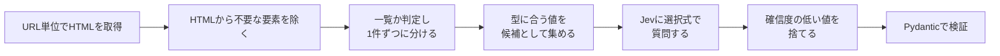

## 概要

Webページから型付きの値を取り出すツール`jevrake`を作りました。
特徴は、取りたい項目の名前・説明・型を書くだけで動くことです。CLI では JSON で、Python からは Pydantic のモデルで指定します。
以下は、[スクレイピング練習用サイト](https://books.toscrape.com/)で試してみた結果です。

```sh:ターミナル
jevrake https://books.toscrape.com/ --fields '{"title": "本のタイトル", "price": {"description": "価格", "type": "decimal"}, "availability": "在庫状況"}'
```

出力は次のとおりです(ページ上の本20冊のうち1冊分)。

```json:出力
{
  "url": "https://books.toscrape.com/",
  "data": {
    "title": "A Light in the ...",
    "price": "51.77",
    "availability": "In stock"
  },
  "fields": {
    "title": {"value": "A Light in the ...", "confidence": 1.0, "probability": 1.0, "source": "A Light in the ..."},
    "price": {"value": "51.77", "confidence": 0.98, "probability": 0.99, "source": "£51.77"},
    "availability": {"value": "In stock", "confidence": 1.0, "probability": 1.0, "source": "In stock"}
  }
}
```

仕組みは単純です。ページから型に合う値を候補として集めます。
その中からどれが目的の値かを、TypeSafe AI の Jev に選ばせます。

この記事では、次の2つを紹介します。

- jevrake の仕組み
- ハマったこと

https://github.com/RKasai127/jevrake

## 背景

作ったきっかけは2つあります。

1つ目は、セレクタを書く手間です。スクレイピングでは、サイトごとにHTMLの構造を見て、`div.price > span` のようなセレクタを書くのですが、これが辛い。。サイトが変わるたびに調べ直しで、改修されれば壊れます。正直、面倒でした。

2つ目は、TypeSafe AI の Jev を試してみたかったことです。
Jev は、文章を生成するのではなく、渡した選択肢から1つを選んで答えるモデルです。答えには確信度が付きます。
ページ上の値から選ぶという使い方に、ちょうど合いそうだと考えました。

## 解決しようとする課題

前セクションと被るところはあるのですが、jevrake で解決したいことは、以下の2つです。

1. セレクタを書かずに、項目名と説明だけで値を取りたい
2. コードを書いたときと同じレベルで正確な値を取りたい

## 解決手段

### 処理の流れ

jevrake は、1ページを次の順に処理します。



おおまかには、Jevへのリクエストを作る処理/Jevへ問い合わせをする処理/整形処理の3つの要素に分かれています。

### 1. 型に合う候補を集める

候補は、次の2段階で集めます。

1. ページから `script` や `style`、`nav`、`footer`、非表示の要素など、不要なものを除きます。残った要素のテキストを、ページの上から順に取り出します
2. 取り出したテキストを、項目の型で絞ります

| 型 | 候補にするもの |
|---|---|
| `str` | テキスト(2〜200文字)。`<title>` と `og:title` も加える |
| `int` / `float` / `decimal` | テキストの中の数値。`¥` `$` `£` `円` などの通貨記号、カンマ、全角数字に対応 |

たとえば価格(`decimal`)なら、「£51.77」は `51.77` として候補になり、数字のない「In stock」は候補になりません。
Jev の選択肢は最大255個です。jevrake では該当なしを表す選択肢のために1つ空けて、候補を254個までにしています。

候補が多い場合は、ページ上の先頭から254個を使います。

### 2. 選択式で Jev に選ばせる

集めた候補を `c0`, `c1`, … という選択肢にして、Jev に質問します。
該当なしを表す `__none__` も必ず入れます。

実際に Jev に送る質問は、`--dry-run` で確認できます。次は books.toscrape.com の2冊目のタイトルの質問です。

```json:jevrake --dry-run の出力(抜粋)
"item1.title": {
  "type": "choice",
  "instructions": "Which option is \"本のタイトル\"? All options come from one item of a list on this page; choose the option that represents the title of that item.",
  "criteria": {
    "c0": "\"Tipping the Velvet\" | <a> | heading h3",
    "c1": "\"£53.74\" | <p class=price_color> | nearby label: Tipping the Velvet",
    "c2": "\"In stock\" | <p class=instock availability> | nearby label: £53.74",
    "c3": "\"Add to basket\" | <button class=btn btn-primary btn-block> | nearby label: In stock",
    "__none__": "None of these is the requested value."
  }
}
```

精度を上げるため、選択肢の説明には、テキストだけでなく、タグ・class・見出しレベル・近くのラベルも入れています。(実際にアリ・なしで計測したわけではないです。)
人間がHTMLを見て判断する手がかりを、そのまま Jev にも渡すイメージです。

あわせて、ページのタイトルと本文(8,000文字まで)を `state` として送ります。

### 3. 確信度の低い値は捨てる

Jev の答えには確信度が付きます。jevrake は、デフォルトで確信度が0.9未満の値を捨てて `null` にします(`--min-confidence` で変更できます)。
間違った値が混ざるのを防ぐためで、課題2(正確な値を取りたい)への対応です。

捨てた値も、出力の `fields` には確信度と元のテキスト(`source`)が残ります。
なぜ `null` になったのかを後から確かめられます。

### 4. 一覧ページは1件ずつに分ける

books.toscrape.com のような[一覧ページ](https://books.toscrape.com/)では、1ページから複数件を取りたいです。
jevrake は、同じ形(タグ名と class が同じ)の要素が3つ以上並ぶ場所を探します。
そのブロックがページのテキストの半分以上を占めていれば、一覧ページとみなします。

:::details 補足:半分以上という基準の根拠
いくつかのページで、繰り返しのブロックがページのテキストに占める割合を測りました(リポジトリの `docs/spec.md` から抜粋)。

| 種類 | ページ | 件数 / 割合 |
|---|---|---|
| 一覧 | books.toscrape.com トップ | 20件 / 57% |
| 一覧 | quotes.toscrape.com トップ | 10件 / 93% |
| 一覧 | Hacker News トップ | 30件 / 54% |
| 詳細 | books.toscrape.com 商品詳細 | 7件 / 10% |
| 詳細 | python.org トップ | 6件 / 9%(最大割合は 5件 / 44%) |
| 詳細 | github.com リポジトリ | 10件 / 8% |

一覧ページは54〜100%、詳細ページは最大44%でした。詳細ページにも3件以上の繰り返しはあるので、件数だけでは区別できません。区別しているのは割合です。
また、連続2件だと誤判定することがあったので3件としています。
:::

一覧ページでは、各ブロックの中の候補だけを選択肢にして、1件ずつ質問します。

## テスト結果

### 一覧ページの結果

books.toscrape.com の[一覧ページ](https://books.toscrape.com/)(本20冊)で、タイトル・価格・在庫状況を取りました。

| 項目 | 取れた件数 | 確信度 |
|---|---|---|
| タイトル | 20冊中20冊 | 0.95〜1.0 |
| 価格 | 20冊中19冊 | 0.90〜0.98(取れなかった1冊は0.88) |
| 在庫状況 | 20冊中20冊 | すべて1.0 |
| 全項目が取れた件数 | 20冊中19冊 | |

取れなかったのは、Scott Pilgrim's Precious Little ... の価格です。Jev は正しい値の £52.29 を選んでいましたが、確信度が0.88で、しきい値の0.9に届かず `null` になりました。
同じページでも、実行ごとに確信度は少し変わります。しきい値の近くの値は、取れたり取れなかったりすることがあります。

:::details 20冊分の結果

| # | タイトル | 価格 | タイトルの確信度 | 価格の確信度 |
|---|---|---|---|---|
| 1 | A Light in the ... | 51.77 | 1.0 | 0.98 |
| 2 | Tipping the Velvet | 53.74 | 1.0 | 0.94 |
| 3 | Soumission | 50.10 | 0.99 | 0.94 |
| 4 | Sharp Objects | 47.82 | 0.97 | 0.94 |
| 5 | Sapiens: A Brief History ... | 54.23 | 0.99 | 0.96 |
| 6 | The Requiem Red | 22.65 | 0.99 | 0.96 |
| 7 | The Dirty Little Secrets ... | 33.34 | 0.97 | 0.96 |
| 8 | The Coming Woman: A ... | 17.93 | 0.99 | 0.94 |
| 9 | The Boys in the ... | 22.60 | 0.99 | 0.94 |
| 10 | The Black Maria | 52.15 | 0.99 | 0.94 |
| 11 | Starving Hearts (Triangular Trade ... | 13.99 | 0.99 | 0.92 |
| 12 | Shakespeare's Sonnets | 20.66 | 0.95 | 0.94 |
| 13 | Set Me Free | 17.46 | 0.97 | 0.94 |
| 14 | Scott Pilgrim's Precious Little ... | `null`(選んだ値は £52.29) | 0.99 | 0.88 |
| 15 | Rip it Up and ... | 35.02 | 0.99 | 0.94 |
| 16 | Our Band Could Be ... | 57.25 | 0.99 | 0.96 |
| 17 | Olio | 23.88 | 0.99 | 0.94 |
| 18 | Mesaerion: The Best Science ... | 37.59 | 0.99 | 0.90 |
| 19 | Libertarianism for Beginners | 51.33 | 0.99 | 0.94 |
| 20 | It's Only the Himalayas | 45.17 | 1.0 | 0.96 |

在庫状況は、20冊すべて In stock(確信度1.0)でした。
:::

:::details 出力の全文

```json:出力
[
  {
    "url": "https://books.toscrape.com/",
    "data": {"title": "A Light in the ...", "price": "51.77", "availability": "In stock"},
    "fields": {
      "title": {"value": "A Light in the ...", "confidence": 1.0, "probability": 1.0, "source": "A Light in the ..."},
      "price": {"value": "51.77", "confidence": 0.98, "probability": 0.99, "source": "£51.77"},
      "availability": {"value": "In stock", "confidence": 1.0, "probability": 1.0, "source": "In stock"}
    }
  },
  {
    "url": "https://books.toscrape.com/",
    "data": {"title": "Tipping the Velvet", "price": "53.74", "availability": "In stock"},
    "fields": {
      "title": {"value": "Tipping the Velvet", "confidence": 1.0, "probability": 1.0, "source": "Tipping the Velvet"},
      "price": {"value": "53.74", "confidence": 0.94, "probability": 0.97, "source": "£53.74"},
      "availability": {"value": "In stock", "confidence": 1.0, "probability": 1.0, "source": "In stock"}
    }
  },
  {
    "url": "https://books.toscrape.com/",
    "data": {"title": "Soumission", "price": "50.10", "availability": "In stock"},
    "fields": {
      "title": {"value": "Soumission", "confidence": 0.99, "probability": 0.99, "source": "Soumission"},
      "price": {"value": "50.10", "confidence": 0.94, "probability": 0.97, "source": "£50.10"},
      "availability": {"value": "In stock", "confidence": 1.0, "probability": 1.0, "source": "In stock"}
    }
  },
  {
    "url": "https://books.toscrape.com/",
    "data": {"title": "Sharp Objects", "price": "47.82", "availability": "In stock"},
    "fields": {
      "title": {"value": "Sharp Objects", "confidence": 0.97, "probability": 0.98, "source": "Sharp Objects"},
      "price": {"value": "47.82", "confidence": 0.94, "probability": 0.97, "source": "£47.82"},
      "availability": {"value": "In stock", "confidence": 1.0, "probability": 1.0, "source": "In stock"}
    }
  },
  {
    "url": "https://books.toscrape.com/",
    "data": {"title": "Sapiens: A Brief History ...", "price": "54.23", "availability": "In stock"},
    "fields": {
      "title": {"value": "Sapiens: A Brief History ...", "confidence": 0.99, "probability": 0.99, "source": "Sapiens: A Brief History ..."},
      "price": {"value": "54.23", "confidence": 0.96, "probability": 0.98, "source": "£54.23"},
      "availability": {"value": "In stock", "confidence": 1.0, "probability": 1.0, "source": "In stock"}
    }
  },
  {
    "url": "https://books.toscrape.com/",
    "data": {"title": "The Requiem Red", "price": "22.65", "availability": "In stock"},
    "fields": {
      "title": {"value": "The Requiem Red", "confidence": 0.99, "probability": 0.99, "source": "The Requiem Red"},
      "price": {"value": "22.65", "confidence": 0.96, "probability": 0.98, "source": "£22.65"},
      "availability": {"value": "In stock", "confidence": 1.0, "probability": 1.0, "source": "In stock"}
    }
  },
  {
    "url": "https://books.toscrape.com/",
    "data": {"title": "The Dirty Little Secrets ...", "price": "33.34", "availability": "In stock"},
    "fields": {
      "title": {"value": "The Dirty Little Secrets ...", "confidence": 0.97, "probability": 0.98, "source": "The Dirty Little Secrets ..."},
      "price": {"value": "33.34", "confidence": 0.96, "probability": 0.98, "source": "£33.34"},
      "availability": {"value": "In stock", "confidence": 1.0, "probability": 1.0, "source": "In stock"}
    }
  },
  {
    "url": "https://books.toscrape.com/",
    "data": {"title": "The Coming Woman: A ...", "price": "17.93", "availability": "In stock"},
    "fields": {
      "title": {"value": "The Coming Woman: A ...", "confidence": 0.99, "probability": 0.99, "source": "The Coming Woman: A ..."},
      "price": {"value": "17.93", "confidence": 0.94, "probability": 0.97, "source": "£17.93"},
      "availability": {"value": "In stock", "confidence": 1.0, "probability": 1.0, "source": "In stock"}
    }
  },
  {
    "url": "https://books.toscrape.com/",
    "data": {"title": "The Boys in the ...", "price": "22.60", "availability": "In stock"},
    "fields": {
      "title": {"value": "The Boys in the ...", "confidence": 0.99, "probability": 0.99, "source": "The Boys in the ..."},
      "price": {"value": "22.60", "confidence": 0.94, "probability": 0.97, "source": "£22.60"},
      "availability": {"value": "In stock", "confidence": 1.0, "probability": 1.0, "source": "In stock"}
    }
  },
  {
    "url": "https://books.toscrape.com/",
    "data": {"title": "The Black Maria", "price": "52.15", "availability": "In stock"},
    "fields": {
      "title": {"value": "The Black Maria", "confidence": 0.99, "probability": 0.99, "source": "The Black Maria"},
      "price": {"value": "52.15", "confidence": 0.94, "probability": 0.97, "source": "£52.15"},
      "availability": {"value": "In stock", "confidence": 1.0, "probability": 1.0, "source": "In stock"}
    }
  },
  {
    "url": "https://books.toscrape.com/",
    "data": {"title": "Starving Hearts (Triangular Trade ...", "price": "13.99", "availability": "In stock"},
    "fields": {
      "title": {"value": "Starving Hearts (Triangular Trade ...", "confidence": 0.99, "probability": 0.99, "source": "Starving Hearts (Triangular Trade ..."},
      "price": {"value": "13.99", "confidence": 0.92, "probability": 0.96, "source": "£13.99"},
      "availability": {"value": "In stock", "confidence": 1.0, "probability": 1.0, "source": "In stock"}
    }
  },
  {
    "url": "https://books.toscrape.com/",
    "data": {"title": "Shakespeare's Sonnets", "price": "20.66", "availability": "In stock"},
    "fields": {
      "title": {"value": "Shakespeare's Sonnets", "confidence": 0.95, "probability": 0.96, "source": "Shakespeare's Sonnets"},
      "price": {"value": "20.66", "confidence": 0.94, "probability": 0.97, "source": "£20.66"},
      "availability": {"value": "In stock", "confidence": 1.0, "probability": 1.0, "source": "In stock"}
    }
  },
  {
    "url": "https://books.toscrape.com/",
    "data": {"title": "Set Me Free", "price": "17.46", "availability": "In stock"},
    "fields": {
      "title": {"value": "Set Me Free", "confidence": 0.97, "probability": 0.98, "source": "Set Me Free"},
      "price": {"value": "17.46", "confidence": 0.94, "probability": 0.97, "source": "£17.46"},
      "availability": {"value": "In stock", "confidence": 1.0, "probability": 1.0, "source": "In stock"}
    }
  },
  {
    "url": "https://books.toscrape.com/",
    "data": {"title": "Scott Pilgrim's Precious Little ...", "price": null, "availability": "In stock"},
    "fields": {
      "title": {"value": "Scott Pilgrim's Precious Little ...", "confidence": 0.99, "probability": 0.99, "source": "Scott Pilgrim's Precious Little ..."},
      "price": {"value": null, "confidence": 0.88, "probability": 0.94, "source": "£52.29"},
      "availability": {"value": "In stock", "confidence": 1.0, "probability": 1.0, "source": "In stock"}
    }
  },
  {
    "url": "https://books.toscrape.com/",
    "data": {"title": "Rip it Up and ...", "price": "35.02", "availability": "In stock"},
    "fields": {
      "title": {"value": "Rip it Up and ...", "confidence": 0.99, "probability": 0.99, "source": "Rip it Up and ..."},
      "price": {"value": "35.02", "confidence": 0.94, "probability": 0.97, "source": "£35.02"},
      "availability": {"value": "In stock", "confidence": 1.0, "probability": 1.0, "source": "In stock"}
    }
  },
  {
    "url": "https://books.toscrape.com/",
    "data": {"title": "Our Band Could Be ...", "price": "57.25", "availability": "In stock"},
    "fields": {
      "title": {"value": "Our Band Could Be ...", "confidence": 0.99, "probability": 0.99, "source": "Our Band Could Be ..."},
      "price": {"value": "57.25", "confidence": 0.96, "probability": 0.98, "source": "£57.25"},
      "availability": {"value": "In stock", "confidence": 1.0, "probability": 1.0, "source": "In stock"}
    }
  },
  {
    "url": "https://books.toscrape.com/",
    "data": {"title": "Olio", "price": "23.88", "availability": "In stock"},
    "fields": {
      "title": {"value": "Olio", "confidence": 0.99, "probability": 0.99, "source": "Olio"},
      "price": {"value": "23.88", "confidence": 0.94, "probability": 0.97, "source": "£23.88"},
      "availability": {"value": "In stock", "confidence": 1.0, "probability": 1.0, "source": "In stock"}
    }
  },
  {
    "url": "https://books.toscrape.com/",
    "data": {"title": "Mesaerion: The Best Science ...", "price": "37.59", "availability": "In stock"},
    "fields": {
      "title": {"value": "Mesaerion: The Best Science ...", "confidence": 0.99, "probability": 0.99, "source": "Mesaerion: The Best Science ..."},
      "price": {"value": "37.59", "confidence": 0.9, "probability": 0.95, "source": "£37.59"},
      "availability": {"value": "In stock", "confidence": 1.0, "probability": 1.0, "source": "In stock"}
    }
  },
  {
    "url": "https://books.toscrape.com/",
    "data": {"title": "Libertarianism for Beginners", "price": "51.33", "availability": "In stock"},
    "fields": {
      "title": {"value": "Libertarianism for Beginners", "confidence": 0.99, "probability": 0.99, "source": "Libertarianism for Beginners"},
      "price": {"value": "51.33", "confidence": 0.94, "probability": 0.97, "source": "£51.33"},
      "availability": {"value": "In stock", "confidence": 1.0, "probability": 1.0, "source": "In stock"}
    }
  },
  {
    "url": "https://books.toscrape.com/",
    "data": {"title": "It's Only the Himalayas", "price": "45.17", "availability": "In stock"},
    "fields": {
      "title": {"value": "It's Only the Himalayas", "confidence": 1.0, "probability": 1.0, "source": "It's Only the Himalayas"},
      "price": {"value": "45.17", "confidence": 0.96, "probability": 0.98, "source": "£45.17"},
      "availability": {"value": "In stock", "confidence": 1.0, "probability": 1.0, "source": "In stock"}
    }
  }
]
```

:::

### 詳細ページの結果

1冊分の[詳細ページ(A Light in the Attic)](https://books.toscrape.com/catalogue/a-light-in-the-attic_1000/index.html)で、タイトル・価格・在庫状況・UPC(商品コード)を取りました。

| 項目 | 結果 | 確信度 | 元のテキスト(`source`) |
|---|---|---|---|
| タイトル | `null` | 0.87 | A Light in the Attic |
| 価格 | `51.77` | 1.0 | £51.77 |
| 在庫状況 | In stock (22 available) | 0.98 | In stock (22 available) |
| UPC | a897fe39b1053632 | 1.0 | a897fe39b1053632 |

価格・在庫状況・UPC は取れました。
タイトルは、正しい値の A Light in the Attic を選んでいます。ただ、確信度が0.87で、しきい値の0.9に届かなかったため `null` になりました。
自信のない値は混ぜないという設計どおりの動きですが、正しい値を捨てることもあるということです。気になる場合は、`--min-confidence` を下げて調整できます。

:::details 出力の全文

```json:出力
[
  {
    "url": "https://books.toscrape.com/catalogue/a-light-in-the-attic_1000/index.html",
    "data": {
      "title": null,
      "price": "51.77",
      "availability": "In stock (22 available)",
      "upc": "a897fe39b1053632"
    },
    "fields": {
      "title": {"value": null, "confidence": 0.87, "probability": 0.88, "source": "A Light in the Attic"},
      "price": {"value": "51.77", "confidence": 1.0, "probability": 1.0, "source": "£51.77"},
      "availability": {"value": "In stock (22 available)", "confidence": 0.98, "probability": 0.98, "source": "In stock (22 available)"},
      "upc": {"value": "a897fe39b1053632", "confidence": 1.0, "probability": 1.0, "source": "a897fe39b1053632"}
    }
  }
]
```

:::

### ページにない項目を指定した結果

同じ詳細ページで、ページ上にない著者名を指定しました。

| 項目 | 結果 | 確信度 | 元のテキスト(`source`) |
|---|---|---|---|
| タイトル | `null` | 0.84 | A Light in the Attic |
| 著者名 | `null` | 0.96 | なし |

著者名は、Jev が該当なしを確信度0.96で選び、`null` になりました。それらしい名前を作ることはなく、ページにない値は入りません。
タイトルは、詳細ページの結果と同じく正しい値の A Light in the Attic を選んでいます。ただ、確信度が0.84で、0.9に届かず `null` になりました。
2回とも、確信度は0.84〜0.87と、しきい値の0.9のすぐ下でした。計算上は、`--min-confidence 0.8` にすれば、どちらの回もタイトルが取れます(この設定での実行はしていません)。

:::details 出力の全文

```json:出力
[
  {
    "url": "https://books.toscrape.com/catalogue/a-light-in-the-attic_1000/index.html",
    "data": {
      "title": null,
      "author": null
    },
    "fields": {
      "title": {"value": null, "confidence": 0.84, "probability": 0.85, "source": "A Light in the Attic"},
      "author": {"value": null, "confidence": 0.96, "probability": 0.96, "source": null}
    }
  }
]
```

:::

### 課題に対する結果

課題1のセレクタについては、どのページでも1行も書かずに値を取れました。
課題2の正確さについては、取れた値はすべて正しい値で、ページにない著者名を作ることもありませんでした。
一方で、正しい値を選んでいても、確信度が0.9に届かず `null` になることがありました。間違った値を混ぜない代わりに、取りこぼしが出る場合があります。

## 使い方

### インストール

```sh:ターミナル
pipx install jevrake
export TYPESAFE_API_KEY=あなたのAPIキー
```

:::message
Python 3.12 以上が必要です。
:::

### CLI で使う

`--fields` に、項目名と説明を JSON で渡します。型を指定するときは `{"description": ..., "type": ...}` と書きます。型は `str` / `int` / `float` / `decimal` です。

```sh:ターミナル
jevrake https://example.com/item/1 --fields '{"title": "商品名", "price": {"description": "価格", "type": "int"}}'
```

:::message
`example.com` は説明用の URL なので、このコマンドはそのままでは動きません。実際に試すときは、概要のコマンドのように対象ページの URL に置き換えてください。
:::

よく使うオプションは次のとおりです。

| オプション | 説明 |
|---|---|
| `-o`, `--output` | 結果の JSON をファイルに書き出す |
| `--min-confidence` | これ未満の確信度の値を `null` にする(既定 0.9) |
| `--delay` | 同じホストへのアクセス間隔(秒、既定 1.0) |
| `--dry-run` | Jev に送る内容を表示するだけで送らない(APIキー不要) |

終了コードは、成功が `0`、一部失敗が `1`、入力エラーが `2`、認証エラーが `3` です。シェルスクリプトから使うときに便利です。

### Python から使う

Python からは、Pydantic のモデルで項目を定義します。`Field` の `description` が質問文に使われます。
次のコードは、リポジトリの `examples/example.py` と同じ内容です。

```py:examples/example.py
from decimal import Decimal

from pydantic import BaseModel, Field

from jevrake import rake


class Book(BaseModel):
    title: str = Field(description="Book title")
    price: Decimal = Field(description="Price")
    availability: str = Field(description="Availability")


results = rake(
    ["https://books.toscrape.com/"],
    Book,
    min_confidence=0.9,
    delay=1.0,
)

for result in results:
    for item in result.items:
        book = item.data
        print(f"{book.title}: £{book.price} ({book.availability})")
    for error in result.errors:
        print(f"[error] {result.url}: {error}")
```

`min_confidence` と `delay` は、CLI の `--min-confidence` と `--delay` と同じ意味です。`dry_run=True` を渡すと、Jev には送らずにリクエストを組み立てるだけになります。

戻り値は1ページにつき1つの `RakeResult` です。`items` に取れた件が、`errors` に失敗の理由が入ります。

必須項目が取れなかった件は捨てられ、`errors` に理由が残ります。一方、取れなかった項目が任意項目(`X | None` か既定値あり)なら、その項目が `None` になります。

:::message alert

- jevrakeはrobots.txt を確認しません。そのため、対象サイトの robots.txt や利用規約を守るのは、利用者の責任です
- JavaScript で描画されるページ、ログインが必要なページには対応していません
:::

## ハマったこと

開発に際し、3つのことにハマりました。それぞれ、症状、原因、対応、教訓の順に紹介します。

### ハマったこと1:一覧ページで1冊分しか取れない

#### 症状

一覧ページから、本20冊のタイトル・価格・在庫状況を取ろうとしました。
20冊×3項目=60問を、1リクエストで送ります。

修正前は、質問文に何件目かを書いていました。質問文はひな形から作り、`{item}` の部分に番号を入れます。2冊目の価格の質問は次のとおりです。

| | 送った内容(英語) | 日本語訳 |
|---|---|---|
| 質問文のひな形 | Which option is "{description}"? Choose the option that represents the {name} of item {item} on this page. | "{description}" はどの選択肢ですか? このページの item {item} の {name} を表す選択肢を選んでください。 |
| 実際の質問文 | Which option is "価格"? Choose the option that represents the price of item 1 on this page. | "価格" はどの選択肢ですか? このページの item 1 の price を表す選択肢を選んでください。 |
| 選択肢 c0 | `"£53.74" \| <p class=price_color> \| nearby label: Tipping the Velvet` | テキスト "£53.74"、タグ `<p class=price_color>`、近くのラベル Tipping the Velvet |
| 選択肢 `__none__` | None of these is the requested value. | どれも求める値ではありません。 |

`{item}` に入るのは、jevrake が一覧を1件ずつのブロックに分けたときの番号です。Python の `enumerate` で付けていたので、0から始まります。

そのため、1冊目が item 0、2冊目が item 1 になり、ページ上の順番より1つ小さい番号になっていました。

プログラムとしては、item 1 は2冊目のつもりです。選択肢にも、2冊目の価格(£53.74)だけを入れています。つまり、正解は c0 しかない質問でした。
なお、state には、ページ全体の本文(20冊すべての書名と価格を含む)を入れています。

:::message
`--dry-run` の出力にある `item1.title` や `item1.price` のようなキーは、質問の名前で、質問文とは別物です。回答をどのブロックのどの項目に戻すかを区別するための識別子で、今も使っています。Jev が読む文章ではありません。
:::

ところが、2〜20冊目の価格は、19冊すべてで該当なし(`__none__`)が返りました。全項目が取れたのは、20冊中1冊だけです。

しかも、該当なしの確信度は0.80〜1.0と高い値でした。迷った結果ではなく、c0 は違うとはっきり判断していたことになります。

#### 原因(推測)

プログラムは0から数えますが、Jev は人と同じように1から数えたと考えられます。
質問文は Jev が読む文章なので、item 1 は1番目の本、つまり1冊目と解釈されたのでしょう。

1. Jev は、item 1 を1冊目と読みます
2. 本文で1冊目を探すと、A Light in the ...(£51.77)が見つかります
3. しかし選択肢には、2冊目の価格の £53.74 しかありません
4. そのため、1冊目の価格は選択肢にないと判断し、該当なしを選んだ

1冊目(item 0)だけが取れたのは、0冊目という本がページ上にないためだと考えられます。番号で探せないので、選択肢の中身だけで判断したのでしょう。

次の修正で、結果は一変しました。

#### 対応

質問文のひな形から番号をなくしました。
変えたのは、ひな形の後半の文だけです。前半の `Which option is "{description}"?`、キーの `item1.price`、選択肢、state は変えていません。

| | ひな形(英語、後半) | 日本語訳 |
|---|---|---|
| 修正前 | Choose the option that represents the {name} of item {item} on this page. | このページの item {item} の {name} を表す選択肢を選んでください。 |
| 修正後 | All options come from one item of a list on this page; choose the option that represents the {name} of that item. | 選択肢はすべて、このページにある一覧の1件から取ったものです。その1件の {name} を表す選択肢を選んでください。 |

`{name}` には項目名(例:`price`)が入ります。`{item}` には一覧のブロックの番号(0始まり。例:2冊目なら `1`)が入ります。

:::details コードの差分

```diff py:src/jevrake/_internal/jev.py
 CHOICE_INSTRUCTIONS = (
     'Which option is "{description}"? Choose the option that represents the {name} of this page.'
 )
+
 ITEM_CHOICE_INSTRUCTIONS = (
-    'Which option is "{description}"? '
-    "Choose the option that represents the {name} of item {item} on this page."
+    'Which option is "{description}"? All options come from one item of a list on this page; '
+    "choose the option that represents the {name} of that item."
 )
```

この修正では、ほかにテスト(`tests/test_jev.py`)の期待値を新しい質問文に合わせただけです。

:::

変えたのは質問文だけです。何冊目かの番号を消し、代わりに選択肢はどれも同じ1冊から取ったものだと伝えるようにしました。選択肢をその1冊分の候補に絞るのは、修正前と同じです。
修正直後の実行では、この修正だけで、全項目が取れた本は20冊中1冊から20冊すべてに増えました。

#### 教訓

モデルの中身が見えるわけではないので、ここからは結果からの推測です。
プログラムの中の番号は0から始まりますが、Jev はプロンプトの番号を人と同じように1から数えて読んだのだと考えています。今回はそのせいで、1冊ずつずれたのでしょう。
このことから、プロンプトには何件目かのような細かい数字の指定を書かないほうが安全だと感じました。本文にメニューなどが混ざると、モデルが正しく数えられるとも限りません。範囲は選択肢の側で絞り、質問文では、選択肢がどれも同じ1冊から取ったものだと伝えるだけにしています。

また、正解が選択肢にあるのに、高い確信度で該当なしが返ってきたら、データよりも質問の伝え方を疑ったほうがよさそうです。

### ハマったこと2:良かれと思って重複をまとめたら精度が落ちた

#### 症状

本の詳細ページから書名と在庫状況を取ろうとしたら、どちらも `null` になりました。
Jev の確信度が、書名は0.51、在庫状況は0.80で、しきい値の0.9に届かなかったためです。
しかも書名は、本文の書名ではなく、サイト名付きのページタイトルを選んでいました。

#### 原因

jevrake は、同じ文字列がページに何度も出てくると、選択肢を1つにまとめていました。
同じ選択肢が並ぶと Jev が迷うと考え、1か所の情報だけを残していたのです。

ところが、捨てた側にこそ大事な手がかりがありました。

| 文字列 | 残した場所 | 捨てた場所 |
|---|---|---|
| A Light in the Attic | パンくずリスト | **h1 見出し** |
| In stock (22 available) | 価格のすぐ下の段落 | **表の Availability の行** |

h1 見出しにあることや、表の Availability の行にあることは、一番の決め手になる情報です。それが Jev に届いていませんでした。

#### 対応

選択肢を1つにまとめるのはそのままにして、出てくる場所はすべて説明に残すようにしました。

```text:在庫状況の選択肢の説明
修正前: "In stock (22 available)" | <p class=instock availability> | nearby label: £51.77
修正後: "In stock (22 available)" | <p class=instock availability> | nearby label: £51.77 ; also at <td> | nearby label: Availability
```

ただし、説明に書く場所は3か所までにしています。Add to basket のようにページ中に何度も出る文字列で、説明が長くなりすぎないようにするためです。

#### 結果

| 項目 | 修正前 | 修正後 |
|---|---|---|
| 在庫状況 | 0.80(`null`) | 0.98(取得) |
| 書名 | 0.51、ページタイトルを選択 | 0.87、正しい書名を選択 |

在庫状況は取れるようになり、書名も正しい文字列を選ぶようになりました。
書名がまだ0.9に届かないのは、ページタイトルも書名を含んでいて、その2つで迷っているためと考えられます。

#### 教訓

どの情報が大事かを、こちらで先回りして決めないことです。
jevrake の役目は、ページにある情報をなるべくそのまま Jev に渡すことです。
どれが正解かの判断は Jev に任せたほうが、精度が上がりました。

### ハマったこと3:PyPI に公開した 0.1.0 の起動エラー

#### 症状

手元のテストもCIも通っていました。しかし PyPI に公開した直後、`pipx install jevrake` で入れて実行すると、import の時点で落ちました。

:::details エラーメッセージ

```text:エラー
ImportError: Modest backend is deprecated since selectolax 1.0. It's outdated, not maintained, contains bugs and does not follow modern HTML5 standards. Please use lexbor backend instead: `from selectolax.lexbor import LexborHTMLParser`.
```

:::

#### 原因

依存している HTML パーサーの selectolax が、1.0 になっていました。
jevrake が使っていた `selectolax.parser`(Modest エンジン)は、1.0 で使えなくなっています。

それでも公開前に気づけなかったのは、確認をすべて開発用の環境で行っていたからです。

| 確認 | 動いた環境 | selectolax |
|---|---|---|
| テスト(`uv run pytest`) | `uv.lock` どおりの開発環境 | 0.4.13 |
| CI(`uv sync --locked` → テスト) | `uv.lock` どおりの環境 | 0.4.13 |
| 実ページでの動作確認(`uv run jevrake`) | 開発環境 | 0.4.13 |
| 公開前のビルド確認(`uv build` + `twine check`) | 形式を調べるだけで、実行していない | 対象外 |
| 利用者の `pipx install jevrake` | PyPI から依存を選び直す | 1.0.0 |

`uv.lock` は、開発とCIのバージョンを固定するファイルです。配布物には含まれません。
配布物に入るのは、`pyproject.toml` の `dependencies` だけです。

そこには `"selectolax"` とだけ書いていたので、利用者の環境には最新の 1.0 が入りました。
lock で固定していたぶん、開発中は古いバージョンで動き続け、変化に気づけませんでした。

#### 対応

1. `selectolax.parser` から `selectolax.lexbor` に切り替えた(使っている API はほぼ互換でした)
2. `pyproject.toml` の依存を `"selectolax>=1.0"` にし、`uv.lock` も 1.0 に更新した
3. PyPI は同じバージョン番号を上書きできないので、0.1.1 として公開した
4. 壊れた 0.1.0 は yank(取り下げ)した。バージョンを指定しないインストールでは選ばれなくなります

#### 教訓

開発中の確認だけでなく、公開後に利用者がインストールする状況を想定した動作確認もしておくべきでした。
AI に聞いたところ、次のようなやり方があるようです。

1. ビルドしたパッケージを、ロックを使わない一時的な環境で動かす
2. TestPyPI に上げてから、利用者と同じ手順でインストールしてみる
3. 依存に下限のバージョンを付ける
4. CI で、ロックを使わず最新の依存でテストする

1つ目は、`uvx` でできます。`uvx` は一時的な環境を作り、`uv.lock` を使わずに依存を選び直します。

```sh:ターミナル
uv build
uvx --from dist/jevrake-0.2.2-py3-none-any.whl jevrake --version
```

2つ目は、本番の PyPI に上げる前に、テスト用の TestPyPI で公開とインストールを試す方法です。jevrake ではまだ試していません。

3つ目は、`pyproject.toml` の `dependencies` に、動作を確認したバージョン以上を指定する方法です。jevrake では、今回の対応で `selectolax>=1.0` にしました。

4つ目は、依存を最新にしてからテストを実行する方法です。依存側の大きな変更に、公開前の普段の PR の時点で気づけます。

```sh:ターミナル
uv sync --upgrade
uv run pytest
```

`uv sync --upgrade` は `uv.lock` も書き換えるので、手元で試したあとは元に戻すか、更新をコミットするかを決めます。

## 今後の課題

現状の課題は、Jev に送る質問の数が多くなりやすいことです。質問の数は、抽出したい項目の数×抽出対象の件数になります。

たとえば、本20冊から3項目を取ると60問です。1,000件の一覧から10項目を取れば、1万問になります(リクエストは20件ごとに分けるので50回です)。

Jev の料金は、質問の数ではなく、送るトークン数で決まります。解説記事によると、入力100万トークンあたり0.042ドルです。

https://www.eesel.ai/blog/typesafe-jev-pricing

質問が増えると、選択肢の説明の分だけ入力トークンが増えます。そのため、件数や項目が増えるほど、お金もかかります。

大量のページを扱う場合は、質問の数を減らす工夫が必要だと考えています。

## まとめ

jevrake は、ページから候補を集める処理と、Jev に選ばせる処理を分けることで、セレクタなしのスクレイピングを実現しました。

セレクタを書くのが面倒だと感じている方は、ぜひ試してもらえると嬉しいです。
GitHub のスター、この記事へのいいねをもらえると励みになります。

ここまで読んでいただきありがとうございます。

https://github.com/RKasai127/jevrake
